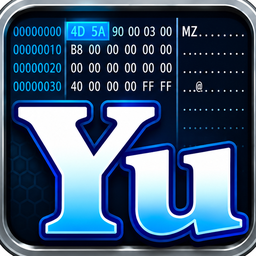
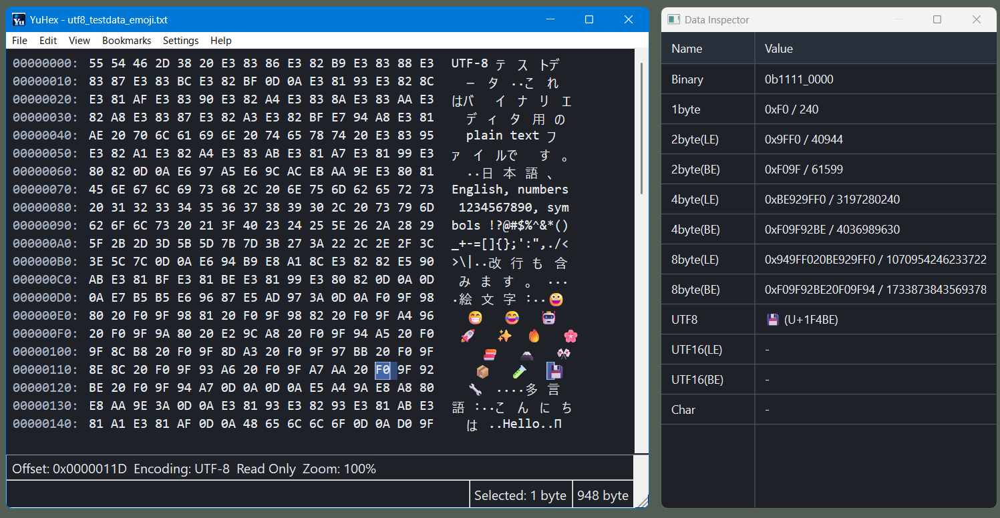
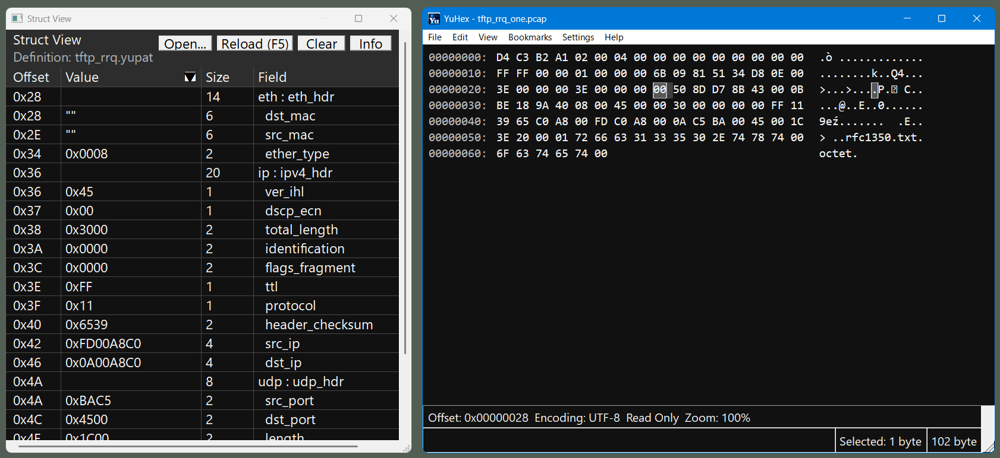
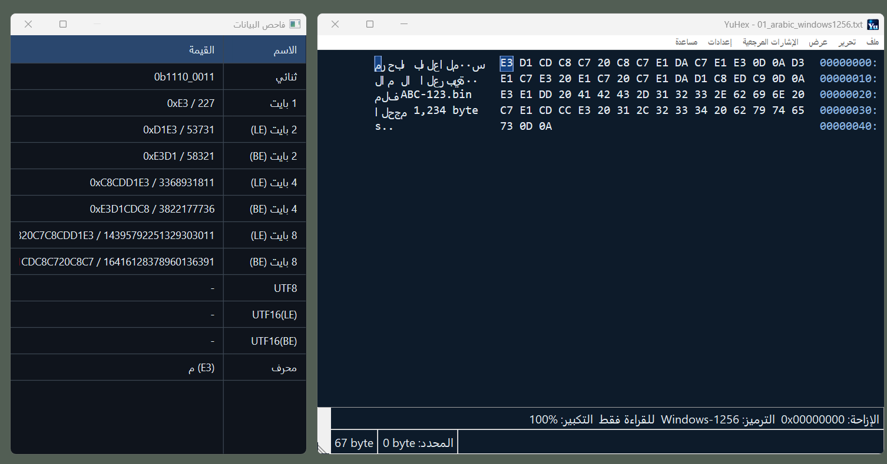

# YuHex Free Edition

**See beyond the bytes. A free, portable hex editor for Windows 11.**

Inspect large files, decode text, explore C structures, and compare binary data—all in an interface that speaks your language. YuHex brings **100 language variants, 107 regional choices, and right-to-left layouts** to everyday binary editing.

**[Download YuHex Free Edition](https://github.com/yutakahirata50/YuHex-releases/releases/latest)**

For **Windows 11 on Intel/AMD 64-bit PCs**. Free for personal and commercial use.

## From raw bytes to useful answers

- **Explore large binary files.** Display and editing have been tested with a 100 GB file.
- **Read bytes as values.** Use the Data Inspector to interpret integers, floating-point values, and characters alongside the hex dump. Display Unicode emoji in full color.
- **Understand file structures.** Load C structure declarations from a `.yupat` definition to inspect field names, types, values, and offsets in Struct View—useful for file headers and packet data.
- **Find the data you need.** Search hexadecimal bytes or text, count matches, and inspect search results. Mark important locations with named, colored bookmarks.
- **Calculate your destination.** Go To (`Ctrl+G`) accepts arithmetic and parentheses. Enter `0x100 + (25-3)*2 + 10/5` to preview offset **302 (`0x12E`)** from the start. You can also move relative to the cursor or the last byte.
- **Edit directly.** Overwrite, insert, delete, cut, and paste hexadecimal text. Adjust the font, zoom, and light or dark theme to suit your work.

*Give binary data a structure: inspect fields and values using C struct definitions.*

## Work in your language

Choose from **100 language variants and 107 regional settings**, with translated menus, dialogs, and search help. RTL layouts support Arabic, Hebrew, Persian, Urdu, Sorani Kurdish, Uyghur in Arabic script, and Divehi.

The Free Edition includes **12 text encodings**: ASCII, UTF-8, UTF-16 LE/BE, Shift_JIS (CP932), Windows-949, EUC-KR, Big5, GBK, TIS-620, Windows-1258, and ISCII for Devanagari.

*RTL interface layouts are available in both editions. This screenshot uses the Store Edition's Windows-1256 decoding; interface language and file encoding are separate settings. Gallery screenshots illustrate features shared by both editions unless stated otherwise.*

## Compare files—and apply the differences

Open two saved files in a separate comparison window. Follow highlighted differences, jump between them, or click the location pane to navigate. Comparison runs in the background, and you can browse either file before it finishes.

After comparison completes, copy a contiguous difference region to the left or right and save each side separately. Resolved differences disappear from the results.

## Download and get started

1. Open the **[latest release](https://github.com/yutakahirata50/YuHex-releases/releases/latest)** and expand **Assets** if necessary.
2. Download `YuHex-…-win-x64.zip`. The automatically generated **Source code** archives are not the application.
3. Extract the ZIP and run `YuHex.exe`.

This repository distributes official YuHex Free Edition releases; it does not contain the application source code. The original, unmodified ZIP archive may be redistributed in its original form.

## Take your workflow further with Microsoft Store

**YuHex for Microsoft Store** builds on the same multilingual editor with parallel search and comparison, additional encodings, Undo/Redo, and export tools.

- **Parallel search and comparison:** configure up to 32 threads to accelerate investigations of large binary files.
- **22 text encodings:** work with additional European, Arabic, and Hebrew encodings alongside the encodings included in the Free Edition.
- **Editor Undo/Redo and edit history:** review your changes and move backward or forward through editing operations.
- **Text dump and C array export:** turn entire files or selected ranges into text dumps or C arrays for documentation and development.

For larger investigations, the Store Edition keeps comparison in the background while you browse, inspect differences, and continue working in the main editor. A **64 GiB full comparison completed in 27.030 seconds with 8 threads** in one measured test after full-read verification, without clearing the OS cache. Performance varies by system, data, and cache state.

**[Discover YuHex on Microsoft Store](https://apps.microsoft.com/detail/9NGBN754VPNB)**
